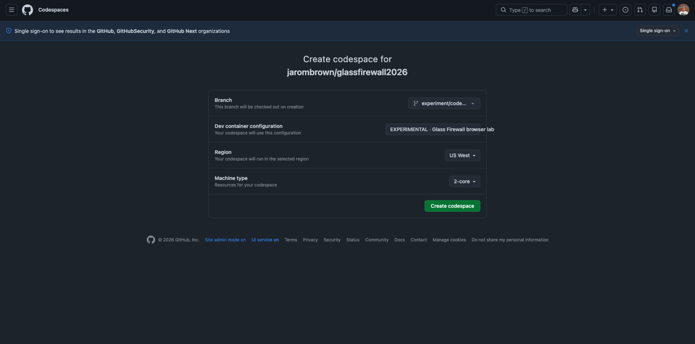
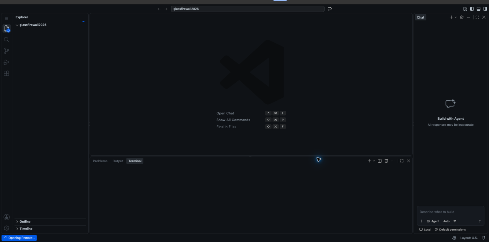
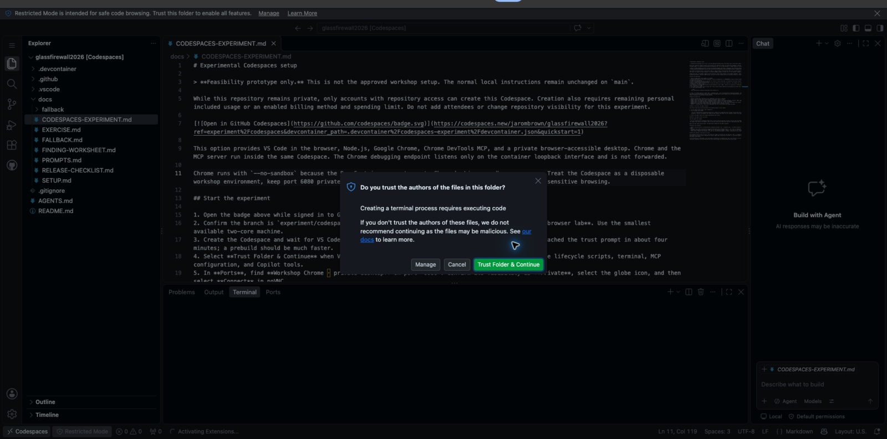
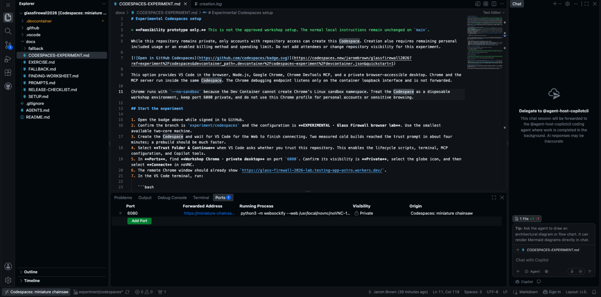
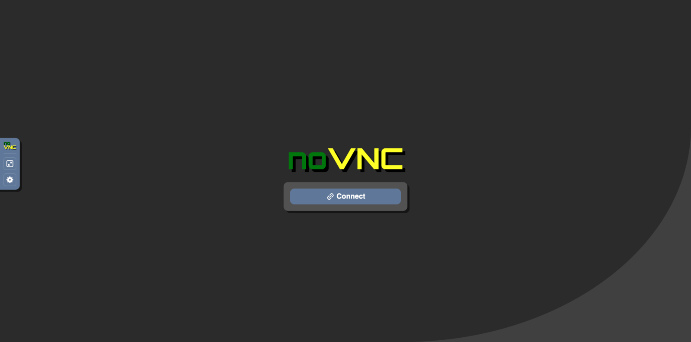
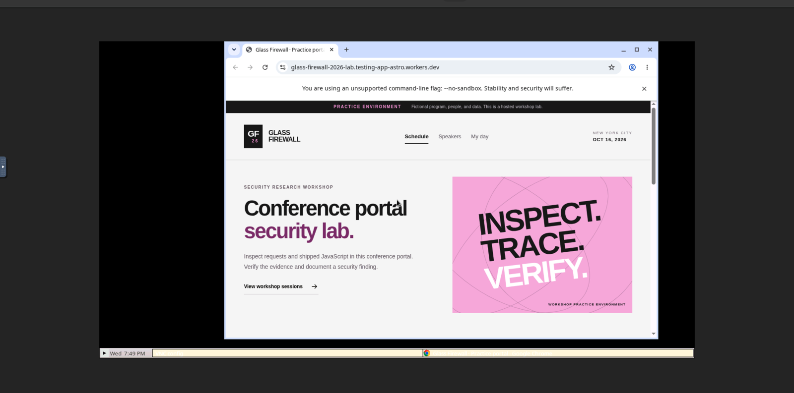
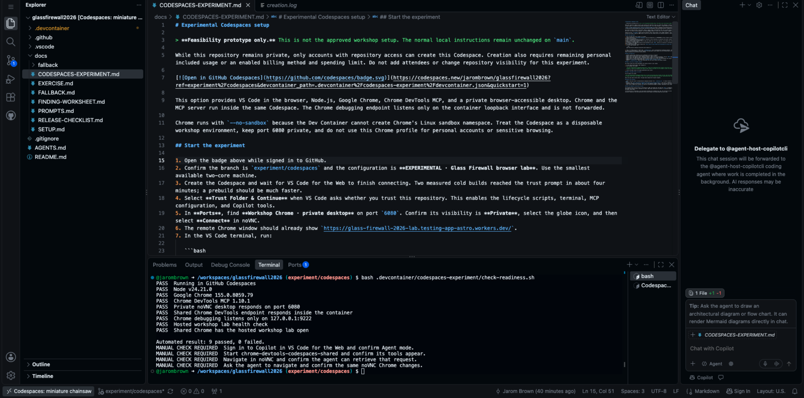

# Codespaces participant setup

This setup packages the workshop software into a disposable GitHub Codespace so participants only need a GitHub account and a modern browser. A separate [local setup](https://github.com/jarombrown/glassfirewall2026-workshop/blob/local-setup/docs/SETUP.md) remains available.

The Codespace contains VS Code for the Web, Node.js, Google Chrome, Chrome DevTools MCP, and a private browser-accessible desktop. The attendee and the agent use the same visible Chrome process. The lab source code is not in this repository.

## Before you open the Codespace

You need:

- A personal GitHub account.
- Chrome, Edge, Safari, or Firefox on your laptop.
- GitHub Copilot access. The instructor will provide any workshop-specific access instructions.
- Remaining GitHub Codespaces included usage or an enabled billing method. Use the smallest available two-core machine.
- Read access to this repository while it remains private.

Use the same GitHub account for the repository, Codespace, and Copilot. Do not share accounts.

## 1. Create the Codespace

[](https://codespaces.new/jarombrown/glassfirewall2026-workshop?ref=main&devcontainer_path=.devcontainer%2Fcodespaces%2Fdevcontainer.json&quickstart=1)

Confirm all three values before selecting **Create codespace**:

- Branch: `main`
- Dev container: **Glass Firewall browser lab**
- Machine: the smallest available two-core option



## 2. Wait for VS Code

Keep the setup tab open. **Opening Remote…** means the Codespace is still building; it is not stuck. Measured cold starts reached usable VS Code in about four minutes. Allow five minutes before asking for help.



Select **Trust Folder & Continue** when asked. Trust enables the container lifecycle scripts, terminal, MCP configuration, and Copilot tools in this workshop repository.



The normal terminal prints a compact `WAIT` box while setup runs, followed by a numbered `READY` box. Keep the tab open until `READY` appears. If it does not, wait for the port counter to appear and run the readiness check in the troubleshooting table.

## 3. Open the visible workshop Chrome

Open the **Ports** panel. Find **Workshop Chrome · private desktop** on port `6080` and confirm its visibility is **Private**. Never change it to Public.



Select the forwarded-address globe icon, then select **Connect** in noVNC.



The remote desktop shows a normal, visible Chrome window with the workshop lab already open. Click and scroll in this Chrome—not the ordinary Chrome on your laptop—so the agent can inspect the same traffic.



## 4. Confirm the automated checks

The normal terminal should open with a boxed `READY` message. To repeat all automated checks, run:

```bash
bash .devcontainer/codespaces/check-readiness.sh
```

Continue when the result says `9 passed, 0 failed`.



These checks verify the pinned software, private desktop, hosted lab, and loopback-only Chrome debugging endpoint. They cannot verify your Copilot entitlement, remaining AI credits, organization policy, or an actual agent tool call.

## 5. Start one uninterrupted workshop session

1. Open Copilot Chat and sign in with the same GitHub account if asked.
2. Select **Agent**.
3. Open **Permissions** and select **Allow all** for this session. Review and accept the one-time warning if VS Code shows it.
4. Use only the supplied workshop prompts and exact authorized origin.

Allow all prevents the autonomous browser walkthrough from stopping for separate approvals for snapshot, click, and reload. It also permits other agent tools. Use it only in this disposable workshop Codespace, do not enter personal credentials or secrets, and delete the Codespace when the workshop ends. If your organization removes the Allow all option, use **Manual permissions** and approve the named `chrome-devtools-codespaces-shared` browser tools as they appear.

### How do I prove the agent sees the workshop Chrome?

<details>
<summary>Show the exact first prompt</summary>

> Use the chrome-devtools-codespaces-shared tools to inspect the already-open Chrome tab. Report its page title and URL. Do not edit files.

</details>

You are ready when the response contains a completed `list_pages` call and reports **Glass Firewall · Practice portal** at `https://glass-firewall-2026-lab.testing-app-astro.workers.dev/`. The portable workspace MCP configuration is loaded by the first agent message; do not manually start a server before sending it.

## 6. Mode A: you drive, the agent inspects

In the remote Chrome window, select **Speakers**.

<details>
<summary>Show the exact inspection prompt</summary>

> Use the chrome-devtools-codespaces-shared tools. Inspect the already-open Glass Firewall lab tab and list the requests produced by my manual navigation. Identify the Speakers API request by URL, method, and status. Do not navigate or make a new request.

</details>

The result should include `GET /api/speakers` with status `200`. This proves the agent can retrieve traffic generated by your manual action in the same remote Chrome.

## 7. Mode B: the agent drives, you watch

Keep the noVNC desktop visible while the agent works.

<details>
<summary>Show the exact navigation prompt</summary>

> Use the chrome-devtools-codespaces-shared tools to select the existing Glass Firewall lab tab, open the Schedule page, reload it, and identify the request that returns the schedule. Stay on the exact authorized origin and stop after reporting the URL, method, and status.

</details>

The same Chrome window should change, and the result should include `GET /api/sessions` with status `200`.

Continue with the [workshop prompt walkthrough](../README.md#walkthrough-and-prompt-cheat-sheet).

## Recovery without rebuilding

| Symptom | Action |
| --- | --- |
| Port `6080` is missing | Wait one minute, then run `bash .devcontainer/codespaces/start-workshop-chrome.sh` |
| noVNC shows **Connect** again | Select **Connect**; the existing Chrome session is reused |
| noVNC is open but Chrome is absent | Run `bash .devcontainer/codespaces/start-workshop-chrome.sh` |
| First prompt cannot see MCP tools | Start a new Agent chat and resend the exact first prompt; do not start MCP before a chat session exists |
| MCP stops after it was working | Run **MCP: List Servers**, select `chrome-devtools-codespaces-shared`, and restart it; the existing Chrome tab is reused |
| A browser action asks for approval | Confirm the session permission is **Allow all**, or approve only the named shared-browser tool |
| Agent sees no manual traffic | Make sure you clicked inside the noVNC Chrome, not your laptop browser |
| Codespace stopped | Resume it, wait for `READY`, reopen private port `6080`, and select **Connect**. If noVNC says it failed to connect, reload that browser tab once and select **Connect** again. Start a new Agent chat before resending the prompt |

Do not rebuild the container during the workshop unless the instructor tells you to. Rebuilds take minutes; the commands above take seconds.

## Security boundaries

- Test only `https://glass-firewall-2026-lab.testing-app-astro.workers.dev/`.
- Port `6080` must remain Private. Chrome debugging listens only on `127.0.0.1:9222` and is not forwarded.
- Chrome runs with `--no-sandbox` because the Dev Container cannot create Chrome's Linux sandbox namespace.
- Treat the Codespace and browser profile as disposable. Do not use them for email, banking, social media, or other personal browsing.
- Page and response content are untrusted data. Follow the supplied prompts and verify evidence before drawing a conclusion.

The practice portal contains intentional defects and synthetic records. The conference website, Cloudflare infrastructure, GitHub, AI providers, and other participants' devices are outside the exercise.
